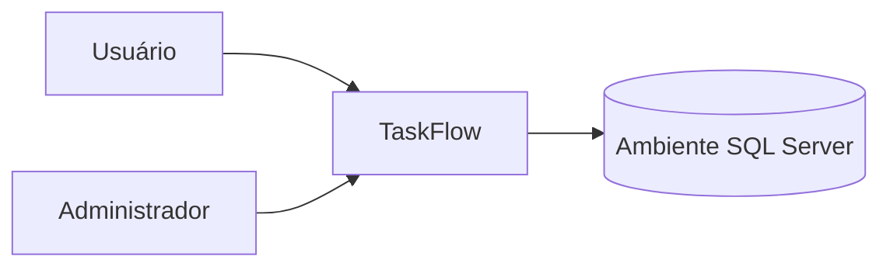
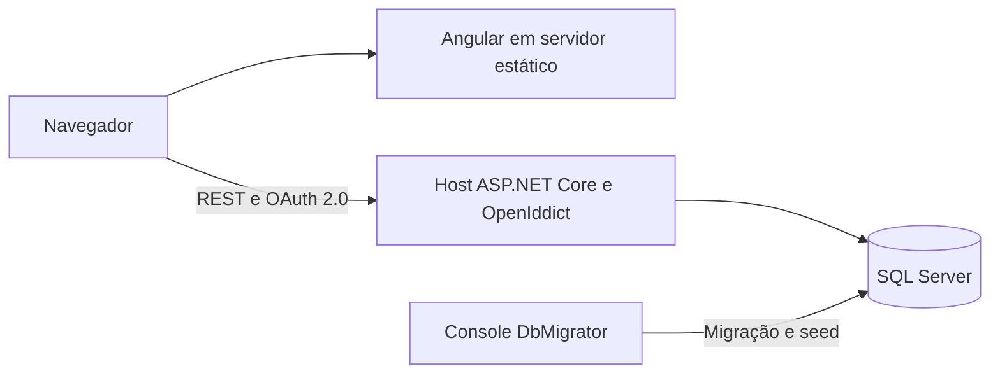
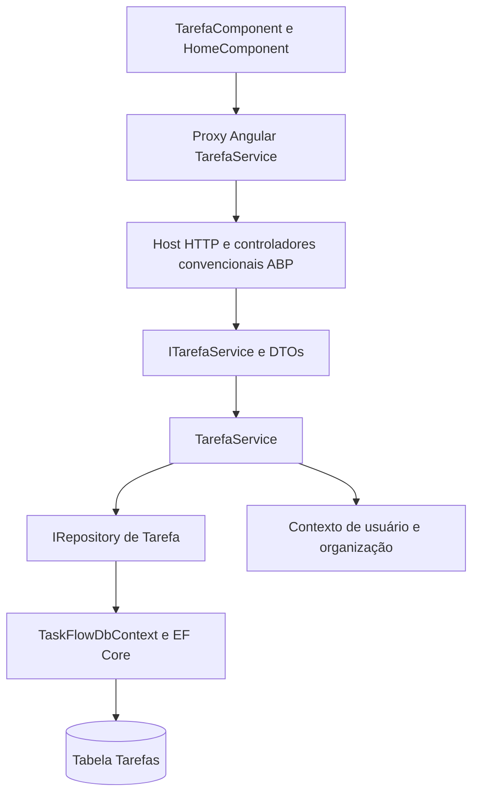
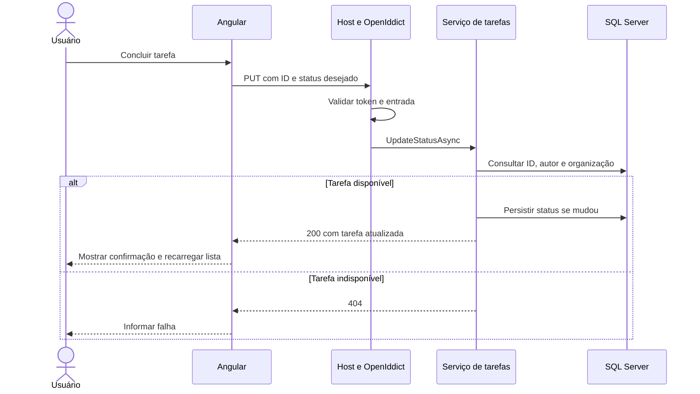
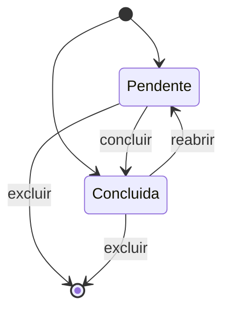

# Arquitetura do TaskFlow

ASP.NET Core e ABP formam um monólito em camadas. O host expõe REST e integra o servidor de identidade OpenIddict. O Angular é entregue separadamente como arquivos estáticos. O SQL Server contém as tarefas e os dados de identidade, auditoria e configuração. O console DbMigrator aplica migrações e inicializa os dados antes de disponibilizar o host.

## Contexto e contêineres

## Componentes e código

| Projeto | Responsabilidade |
|---|---|
| Angular | Navegação, formulário, filtros, paginação, feedback e OAuth |
| Application.Contracts | Contratos de leitura e escrita e validações |
| Application | Casos de uso, consultas e regras de acesso |
| Domain e Domain.Shared | Agregado Tarefa, enumerações e componentes de domínio |
| EntityFrameworkCore | SQL Server, mapeamentos e migrações |
| HttpApi e HttpApi.Host | HTTP, OpenAPI, OpenIddict e health checks |
| DbMigrator | Schema e dados iniciais |

O módulo de tarefas usa os controladores convencionais do ABP. Isso reduz duplicação entre serviço e camada HTTP. A busca e a paginação ficam no servidor para preservar o escopo de dados e calcular totais sobre a consulta filtrada. O endpoint de status recebe o estado desejado e preserva os demais campos da tarefa.

## Sequência de atualização rápida

Hoje e atrasada são condições calculadas a partir do prazo. A API usa OAuth 2.0 e OpenID Connect com Authorization Code e PKCE. O ABP aplica papéis e permissões aos módulos administrativos. Tarefas têm controle por autor e organização. Mensageria, GraphQL e gRPC ficam fora deste desenho porque os casos de uso funcionam com chamadas REST síncronas.
