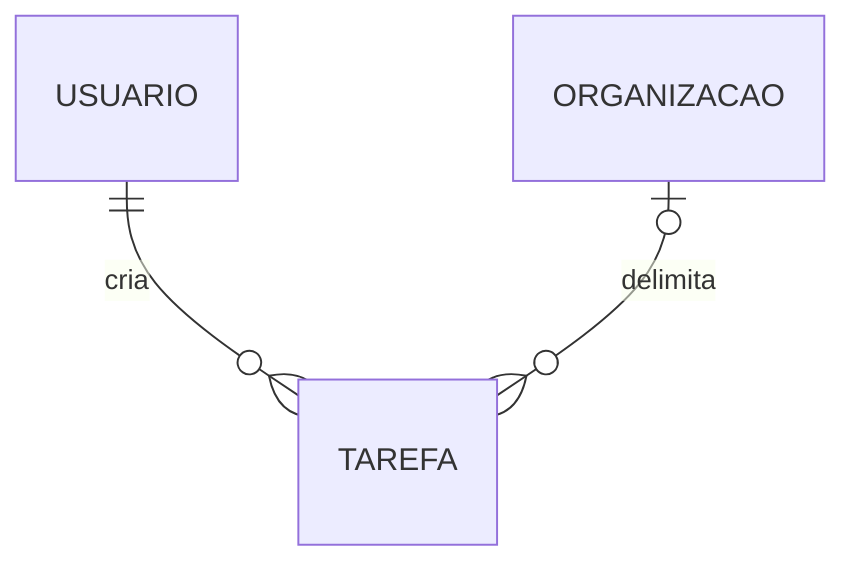
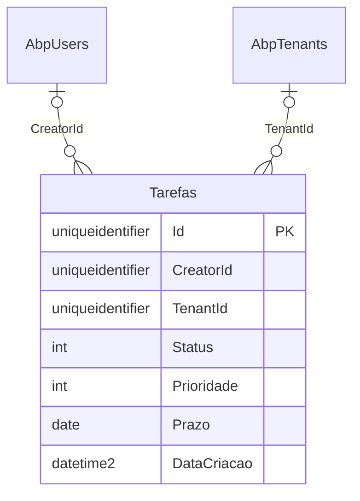

# Modelo e dicionário de dados

O usuário cria tarefas. Uma tarefa pertence ao contexto da organização em que foi criada. O contexto administrativo principal é representado por organização nula.

As relações do DER representam referências lógicas. A tabela Tarefas possui chave primária em Id. CreatorId e TenantId não são chaves estrangeiras físicas no modelo atual. O índice IX_Tarefas_TenantId_CreatorId atende ao recorte de tarefas pessoais.

| Coluna | Tipo SQL Server | Nula | Origem e restrições |
|---|---|---|---|
| Id | uniqueidentifier | Não | Identificador da tarefa |
| TenantId | uniqueidentifier | Sim | Organização atual, ou contexto principal |
| CreatorId | uniqueidentifier | Sim | Autor registrado pelo ABP. Registros legados sem autor ficam fora da API |
| Titulo | nvarchar(max) | Não | Entrada obrigatória, máximo de 200 caracteres na API |
| Descricao | nvarchar(max) | Não | Entrada obrigatória, máximo de 4.000 caracteres na API |
| Status | int | Não | 0 pendente, 1 concluída. Validado na API |
| Prioridade | int | Não | 0 normal, 1 baixa, 2 alta. Padrão SQL 0 e validação na API |
| Prazo | date | Sim | Dia de calendário, sem informação de horário |
| DataCriacao | datetime2 | Não | Definida pelo servidor ao criar e preservada ao editar |
| CreationTime | datetime2 | Não | Registro de criação do ABP |
| LastModificationTime | datetime2 | Sim | Atualização registrada pelo ABP |
| LastModifierId | uniqueidentifier | Sim | Último usuário que alterou a tarefa |
| ExtraProperties | nvarchar(max) | Não | Propriedades estendidas do ABP |
| ConcurrencyStamp | nvarchar(40) | Não | Marcador de concorrência otimista verificado pelo EF Core |

Os módulos ABP gerenciam as tabelas auxiliares, incluindo AbpUsers, AbpRoles, AbpTenants e AbpAuditLogs. O snapshot do EF Core é a referência completa de tipos, chaves e índices físicos.

A migração AddTaskPriorityAndDueDate acrescenta duas colunas e mantém as tarefas existentes. A reversão dessa migração elimina os prazos e prioridades preenchidos após a atualização. Faça backup e avalie o impacto antes de reverter.
