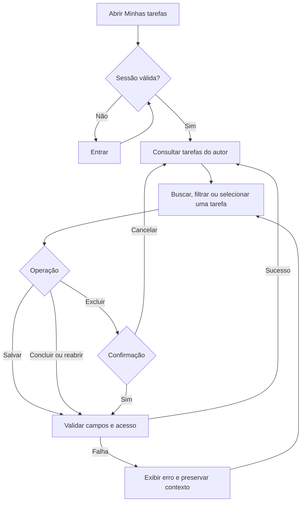

# Requisitos do TaskFlow

O TaskFlow organiza tarefas pessoais em uma aplicação web. O usuário autenticado gerencia as tarefas que criou na organização atual. Administradores mantêm usuários, papéis e organizações pelos módulos do ABP.

| ID | Necessidade | Critério de aceite | Situação |
|---|---|---|---|
| RF-01 | Entrar no sistema | O login retorna à aplicação e identifica o usuário. As operações de tarefas exigem autenticação. | Existente |
| RF-02 | Cadastrar e editar tarefas | Título, descrição e status são validados. Edição preserva identificador, autor, organização e data de criação. | Existente |
| RF-03 | Consultar tarefas pessoais | A lista usa paginação e só retorna tarefas do autor na organização atual. Consultas por ID respeitam o mesmo escopo. | Existente |
| RF-04 | Excluir tarefas | A interface pede confirmação. A API permite a exclusão somente ao autor no contexto correto. | Existente |
| RF-05 | Buscar e filtrar | A lista encontra termos no título ou na descrição e permite combinar busca, situação e prioridade antes da paginação. | Nova entrega |
| RF-06 | Definir prioridade e prazo | O usuário pode escolher prioridade baixa, normal ou alta e informar uma data opcional. Registros antigos recebem prioridade normal e ficam sem prazo. | Nova entrega |
| RF-07 | Concluir ou reabrir rapidamente | Uma ação na lista alterna o status e preserva os demais dados. Em caso de erro, o status exibido continua sendo o último confirmado. | Nova entrega |
| RF-08 | Acompanhar tarefas | A visão geral exibe totais pessoais de pendentes, tarefas de hoje, atrasadas e concluídas. Cada indicador abre o filtro correspondente. | Nova entrega |
| RF-09 | Usar em telas pequenas | Os fluxos de consulta e edição funcionam por teclado e em largura de 360 px, sem rolagem horizontal da página. | Critério da nova interface |

| ID | Atributo | Critério ou meta |
|---|---|---|
| RNF-01 | Segurança | API autenticada, isolamento por autor e organização e segredos fornecidos pelo ambiente. A implantação compartilhada usa HTTPS. |
| RNF-02 | Desempenho | Meta inicial de p95 ≤ 500 ms para listagem e resumo, com 10 usuários concorrentes, 1.000 tarefas por usuário e cinco minutos de medição após aquecimento. Registrar ambiente, amostras e taxa de erro. |
| RNF-03 | Disponibilidade | Meta inicial de 99,5% por mês para a API pronta. Medir por sondagem autenticada de leitura e checagem de prontidão. |
| RNF-04 | Recuperação | Metas iniciais de RPO de 24 h e RTO de 2 h. Validar em restauração controlada antes de assumir compromisso operacional. |
| RNF-05 | Manutenção | Compilar e testar backend e frontend em CI. Revisar a matriz quando regras ou contratos mudarem. |
| RNF-06 | Privacidade | Registrar dados necessários ao uso e à auditoria, controlar acesso a logs e backups e definir retenção e tratamento de solicitações antes de operar com dados reais. |

As metas operacionais são propostas de aceitação e dependem de medição no ambiente escolhido. O responsável pela operação define retenção, base legal e procedimentos para atender solicitações de titulares conforme o contexto de uso.

## Regras de negócio

| ID | Regra |
|---|---|
| RN-01 | Toda leitura ou alteração de tarefa exige usuário autenticado e verifica autor e organização. IDs indisponíveis no contexto retornam o mesmo resultado de tarefa inexistente. |
| RN-02 | Título e descrição são obrigatórios e aceitam até 200 e 4.000 caracteres. Texto composto apenas de espaços é inválido. Status e prioridade aceitam somente valores definidos. |
| RN-03 | Autor, organização e data de criação são atribuídos pelo servidor. A edição não altera esses dados. |
| RN-04 | O prazo representa um dia do calendário, sem horário. Uma tarefa pendente com prazo anterior ao dia de referência está atrasada. Uma pendente com prazo igual está prevista para hoje. Concluídas e tarefas sem prazo ficam fora desses recortes. |
| RN-05 | Pendente pode passar a concluída e concluída pode voltar a pendente. A operação rápida recebe o estado desejado, sem alternar no servidor a cada repetição do pedido. |
| RN-06 | Ao excluir, a interface solicita confirmação. A exclusão remove a tarefa da lista e do resumo. |
| RN-07 | Busca, filtros e contagens usam o mesmo escopo de acesso. A tela envia a data local do usuário para classificar prazos. |

## Casos de uso

| Caso | Fluxo principal | Alternativas | Exceções |
|---|---|---|---|
| UC-01 Entrar | Abrir a aplicação, selecionar Entrar, autenticar e acessar a visão geral. | Retornar à página solicitada pelo fluxo de login. | Credencial inválida mantém o usuário no login. |
| UC-02 Cadastrar ou editar | Abrir formulário, preencher dados válidos e salvar. A lista mostra o resultado. | Na criação, prioridade normal e prazo vazio. Na edição, carregar os valores cadastrados. | Validação mantém o formulário aberto. Erro de rede permite nova tentativa. Tarefa indisponível é tratada pela API. |
| UC-03 Localizar | Abrir a lista, digitar termo ou escolher situação e prioridade. Percorrer páginas de resultados. | Limpar filtros. Abrir filtro pela visão geral. | Exibir estado vazio ou erro com opção de repetir a consulta. |
| UC-04 Alterar status | Selecionar concluir ou reabrir na tarefa. Atualizar a lista após confirmação da API. | Alterar status pelo formulário. | Preservar os dados exibidos quando o servidor recusar a mudança. |
| UC-05 Excluir | Selecionar excluir, confirmar e atualizar a lista. | Cancelar e permanecer na lista. | Informar erro e permitir nova tentativa. |
| UC-06 Acompanhar | Consultar contadores na visão geral e abrir o recorte desejado. | Abrir a lista completa. | Informar falha na consulta e permitir tentar novamente. |

